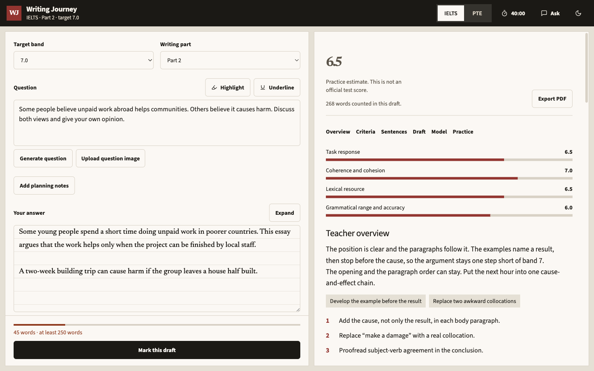
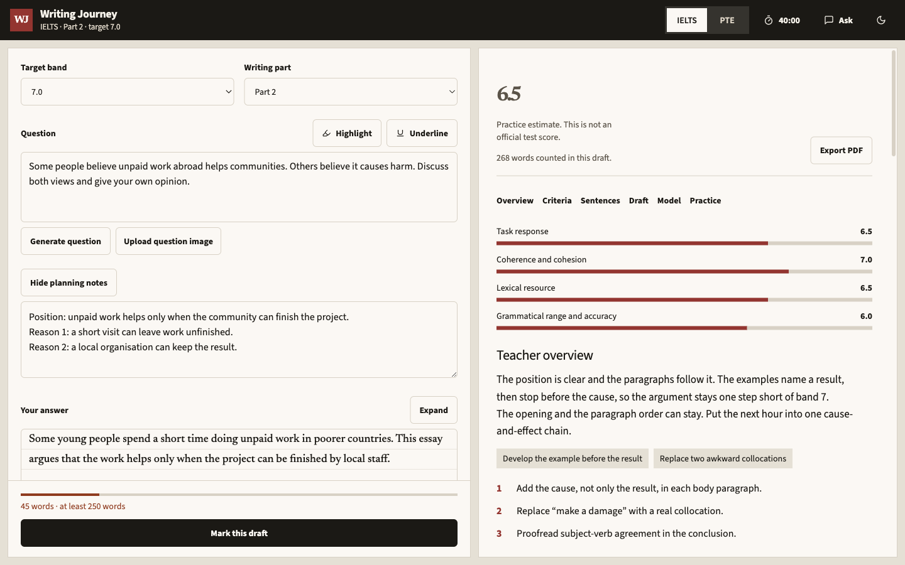
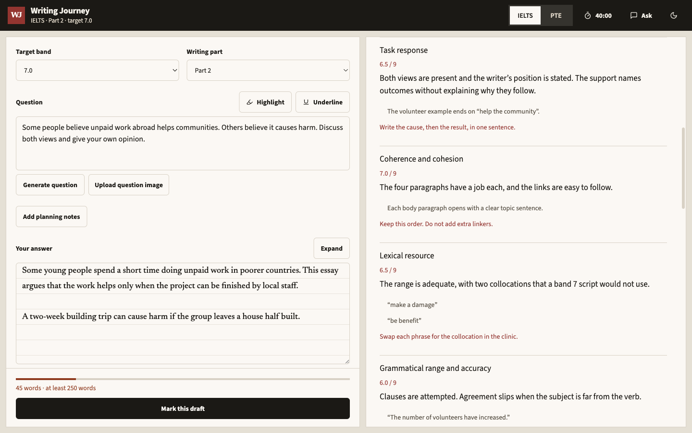
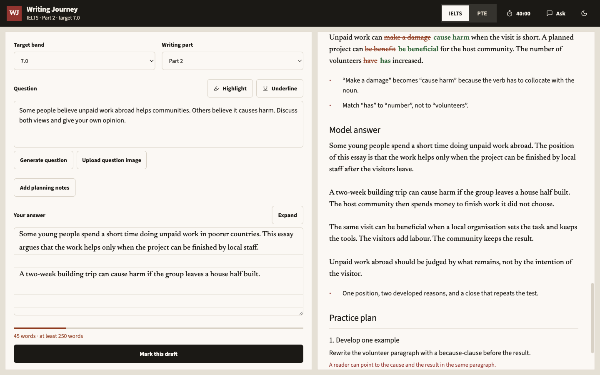
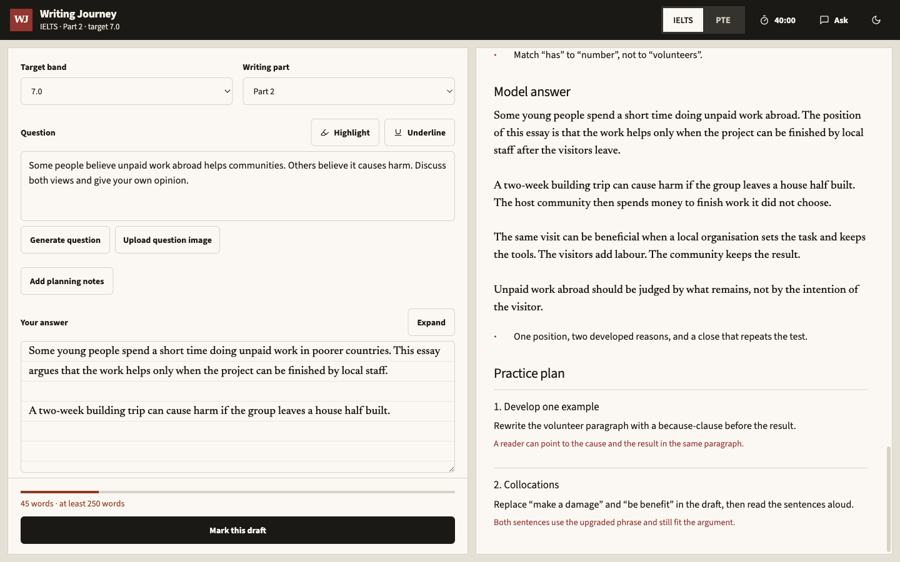
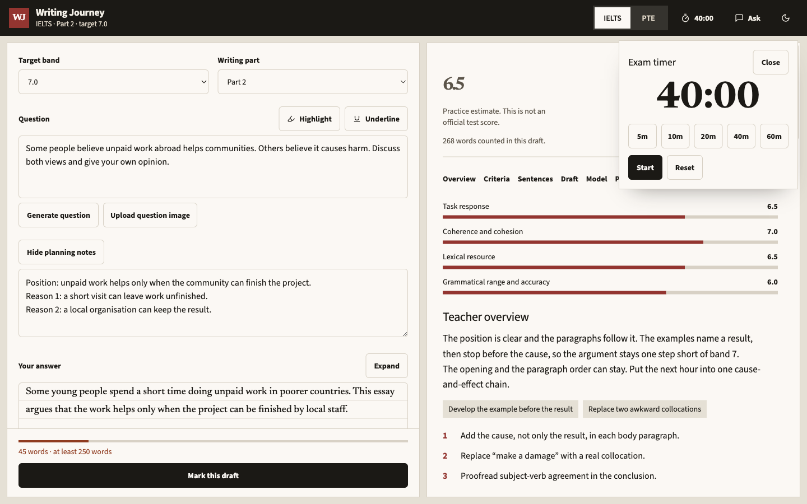
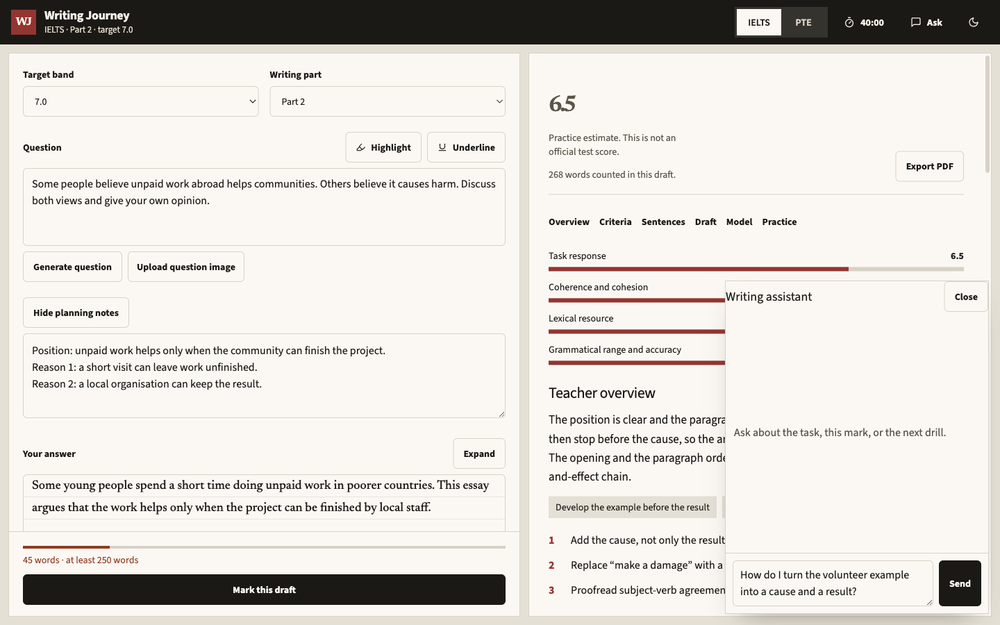

# Writing Journey

Writing Journey marks an IELTS or PTE writing draft. You get a practice score, the evidence behind each criterion, a corrected script, a model answer, and the next drill.

---

**APP** [Live Demo](https://ielts-writing-boost.vercel.app)

## What you can do

- **Read the mark.** The practice band and each criterion sit on one sheet, with the reason under the score.
- **See the repair.** A wrong phrase stays in the script, struck through, with the replacement beside it.
- **Compare and practise.** Read a model answer for the same task, then follow a drill with a clear success check.
- **Use both exams.** IELTS Part 1 and Part 2, and PTE Summarize Written Text and Write Essay. Part 1 can include a question image.
- **Keep the draft and the mark in view.** The script stays on the left. The mark sheet stays on the right.

## Configuration

The app calls NVIDIA NIM at `https://integrate.api.nvidia.com/v1`.

Set `NVIDIA_NIM_API_KEY_1` through `NVIDIA_NIM_API_KEY_9` in `.env`.
You can also set `NVIDIA_NIM_API_KEYS` as a comma-separated list. Those keys load first.

The pool rotates keys and keeps a 30 request per minute pace on each key.
A bad key is paused for 10 minutes.
A failed model moves to the end of the chain for 2 minutes.
Scoring uses `nvidia/nemotron-3-ultra-550b-a55b`.
Short agents use `poolside/laguna-xs-2.1`.
Chart images use `nvidia/nemotron-3.5-super-vl-120b-a12b`.
Thinking is off. JSON agents request `response_format: json_object`.
The service streams from NIM and assembles the reply before it returns JSON.
Prefix cache hits show up as `cachedTokens` on each agent trace.

Check `GET /health` for the key count. The response does not include key values.

## How it works

1. Choose the exam, the target, and the writing task.
2. Paste the question and the draft. Add a question image or a planning note if you need one.
3. Mark the draft. Read the sheet, the corrected script, the model, and the practice plan.

---

**The desk**

**Planning notes**

**Criterion evidence**

**Corrected draft**

**Model answer**

**Exam timer**

**Writing assistant**

